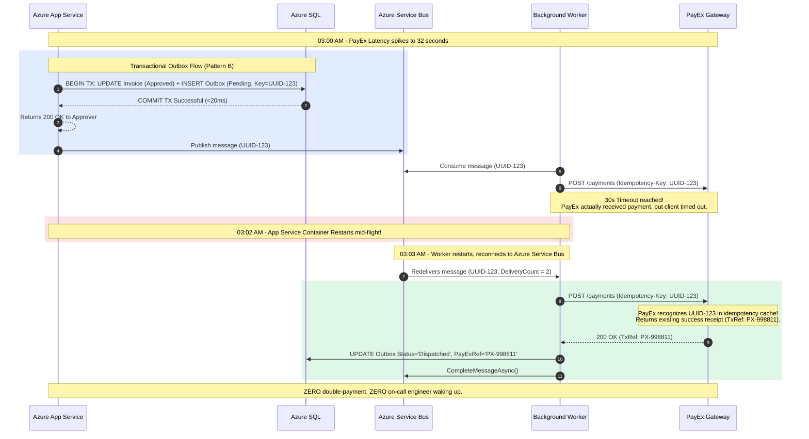

# ADR-001: Exactly-Once Invoice Payment Submission to PayEx

| Metadata | Details |
|---|---|
| **Status** | **Accepted** |
| **Date** | 2026-10-31 |
| **Authors** | Senior Engineering Team |
| **Deciders** | Tech Lead, Senior Software Engineer, Operations / On-Call Lead |
| **Consulted** | Finance Operations, Security & Compliance Lead |
| **Informed** | Engineering Team (6 on-call engineers), Product Management |

---

## 1. Context & Problem Statement

The **Invoice Approval Service** is transitioning from an internal prototype to a **Tier-2 mission-critical production service**. 

### 1.1 Scale & Workload Characteristics
- **Monthly Volume:** ~40,000 invoices/month.
- **Clustering:** 60% of monthly volume (~24,000 invoices) occurs in the **final 3 working days of the month**.
- **Peak Throughput:** Over **80 approvals per minute** during month-end business hours.
- **Operational Cadence:** 24/7 on-call rotation among 6 engineers (2 of whom are completely new to the codebase).

### 1.2 Integration Partner: PayEx
Approved invoices must disburse real money via an external third-party payment gateway called **PayEx**.
PayEx exhibits specific operational behaviors:
1. PayEx provides an HTTPS REST endpoint for payment disbursement.
2. PayEx specifies a **30-second request timeout**.
3. **Critical Reliability Axiom:** A timeout or network failure **does not mean the transaction failed**. PayEx may have received, processed, and disbursed funds, but the HTTP response was lost due to network drop or intermediate proxy timeout.
4. If a failed or timed-out request is blindly resent without deterministic idempotency, **the vendor will be paid twice**.

### 1.3 Compliance & Auditability
A SOC 2 Type II compliance audit is scheduled in 6 months. All approval actions, timestamps, approver identities, and payment disbursement outcomes must be strictly auditable and tamper-proof for **7 years**.

### 1.4 The Decision Problem
How do we architect the payment submission pipeline to **guarantee exactly-once payment execution** against PayEx, absorb month-end traffic bursts (80 req/min), survive transient network latency spikes (32s+), and ensure seamless resilience across App Service restarts with minimal on-call human intervention?

---

## 2. Patterns Evaluated

We evaluated three architectural patterns:

```
┌────────────────────────────────────────────────────────────────────────────────────────┐
│ Pattern A: Idempotency Key + Deduplication Table (Synchronous)                         │
│ Client/API generates unique UUID. API calls PayEx synchronously; records dedupe table. │
├────────────────────────────────────────────────────────────────────────────────────────┤
│ Pattern B: Transactional Outbox + Asynchronous Service Bus Worker (Selected)           │
│ Approval & Outbox entry written in single ACID transaction. Worker dispatches async.   │
├────────────────────────────────────────────────────────────────────────────────────────┤
│ Pattern C: Optimistic Synchronous Submission + Nightly Reconciliation Batch            │
│ Synchronous submit; on error/timeout, defer resolution to nightly settlement report.   │
└────────────────────────────────────────────────────────────────────────────────────────┘
```

### Pattern A: Client-Generated Idempotency Key + Local Deduplication Table
* **Mechanism:** The Web API generates a deterministic idempotency key (e.g., `SHA256(InvoiceId + InvoiceAmount)`) and writes it to an Azure SQL `PaymentDedupe` table in state `Initiated`. The API makes a synchronous HTTP POST call to PayEx with header `Idempotency-Key: {Key}`. When PayEx responds, the table is updated to `Completed` with the `PayExTransactionRef`.
* **Strengths:** Simple to understand; relies on PayEx's server-side idempotency cache.
* **Fatal Flaws:**
  - **Thread Starvation:** Synchronous HTTP calls during a 30-second PayEx latency spike tie up ASP.NET request threads. Under 80 approvals/min, 40+ threads remain blocked simultaneously, exhausting the thread pool and cascading into HTTP 503 errors for other API users.
  - **App Service Recycles:** If the Azure App Service container recycles or restarts mid-request (at $t = 28\text{s}$), the HTTP connection is severed. The dedupe table remains in `Initiated` state indefinitely, requiring manual investigation by the on-call engineer.

### Pattern B: Transactional Outbox + Asynchronous Worker (Azure Service Bus)
* **Mechanism:**
  1. Inside `ApprovalService.Approve()`, a single ACID SQL transaction commits:
     - Updates `Invoices` table: `Status = 'Approved'`, `DecidedBy`, `DecidedAt`.
     - Inserts record into `OutboxMessages` table: `Id`, `InvoiceId`, `IdempotencyKey`, `Payload`, `Status = 'Pending'`, `CreatedAt`.
  2. The HTTP request returns `200 OK` to the approver immediately ($< 100\text{ms}$).
  3. A lightweight background publisher relays pending outbox messages to the already-provisioned **Azure Service Bus** topic (`invoice-approved-topic`).
  4. An asynchronous worker (`PaymentDispatcherWorker`) consumes the message, issues the HTTPS call to PayEx with `Idempotency-Key: {IdempotencyKey}`, and records the outcome.
  5. If PayEx times out or errors, Azure Service Bus applies exponential backoff with jitter and redelivers with the **same** idempotency key. Poison messages dead-letter to a DLQ after 5 attempts.
* **Strengths:**
  - **Zero User-Perceived Latency:** Approvers experience sub-second approvals regardless of PayEx response times.
  - **Decoupled Throughput:** Ingestion rate (80 req/min) is completely decoupled from downstream payment execution rate.
  - **Crash Resilience:** If App Service crashes at 3:00 AM, the outbox record and Service Bus message persist in durable storage. Upon reboot, the worker picks up exactly where it left off.
  - **Zero Duplicate Disbursements:** Guaranteed by pairing the durable outbox entry with deterministic idempotency keys.
* **Trade-offs:** Additional asynchronous components to monitor (outbox publisher, Service Bus subscription).

### Pattern C: Optimistic Submission + Nightly Reconciliation Batch
* **Mechanism:** The API attempts a direct synchronous call to PayEx. If the call succeeds, the invoice is marked `Paid`. If the call times out (30s) or fails, the invoice status is marked `PendingReconciliation`. At 02:00 AM daily, a scheduled cron script downloads PayEx’s settlement CSV, matches records against `PendingReconciliation` invoices, and updates balances.
* **Fatal Flaws:**
  - **Unacceptable Month-End Business Delay:** During the last 3 days of the month, finance requires immediate confirmation of vendor disbursements. Leaving invoices in `PendingReconciliation` for up to 24 hours prevents month-end general ledger closing.
  - **Cascading HTTP Failures:** Suffers identical thread starvation to Pattern A under 80 approvals/min.
  - **Audit Non-Compliance:** SOC 2 auditors flag 24-hour financial ambiguity windows as a severe deficiency in financial transaction controls.

---

## 3. Pattern Comparison Matrix

| Evaluation Criteria | Pattern A: Idempotency + Dedupe | Pattern B: Transactional Outbox + Worker | Pattern C: Optimistic + Nightly Recon |
|---|---|---|---|
| **Exactly-Once Guarantee** | High (if client retries) | **Absolute (ACID + Idempotency)** | Low (blind window until overnight) |
| **Resilience to 30s Timeouts** | Poor (blocks HTTP thread) | **Flawless (asynchronous isolation)** | Poor (blocks HTTP thread) |
| **80 req/min Month-End Surge** | Degrades / Thread pool exhaustion | **Smooth (Service Bus queues load)** | Degrades / High error rates |
| **3:00 AM App Service Restart** | Leaves orphaned `Initiated` records | **Self-healing upon reboot** | Requires manual morning triage |
| **Engineering Build Effort** | ~35 hours | **~45 hours** | ~20 hrs API + 70 hrs Recon script |
| **Monthly Cloud Run Cost** | ~$0 (uses existing DB) | **<$15/mo** (Azure Service Bus provisioned) | ~$0 (higher compute during batch) |
| **On-Call Alert Noise (Toil)** | High (interrupted connections) | **Minimal (automated DLQ alerts only)** | Severe (finance escalation queue) |
| **SOC 2 Type II Auditability** | Moderate | **High (full immutable event lifecycle)** | Fails financial timeliness control |

---

## 4. The 3:00 AM Month-End Failure Stress Test

### The Failure Scenario
- **Time:** 03:00 AM, January 31 (month-end peak).
- **Incident:** PayEx upstream gateway experiences network degradation; latency spikes to **32 seconds** (exceeding our 30-second HTTP timeout).
- **Compounding Event:** Azure App Service platform maintenance triggers an automatic container restart / recycling at **03:02 AM**.

### Detailed Failure Mode Analysis Across Patterns



1. **How Pattern C (Optimistic) Fails Disastrously:**
   - Approvals submitted at 03:00 AM time out at 30 seconds.
   - App Service restarts at 03:02 AM, wiping in-memory HTTP client contexts.
   - 14 invoices remain in `PendingReconciliation` status.
   - The on-call engineer is paged at 03:15 AM because payments have halted. The engineer cannot determine if PayEx processed the funds without calling PayEx emergency support or waiting 22 hours for the nightly reconciliation report. If the engineer pushes a manual retry, the vendor is double-paid.
2. **How Pattern B (Transactional Outbox + Worker) Triumphs:**
   - At 03:00 AM, the approval and outbox record were committed atomically to Azure SQL.
   - When the worker timed out and the App Service restarted at 03:02 AM, the message remained locked in Azure Service Bus.
   - Upon container recovery at 03:03 AM, the worker re-receives the message with `DeliveryCount = 2`.
   - The worker re-submits to PayEx using the **exact same `Idempotency-Key`**.
   - PayEx checks its idempotency ledger, recognizes `UUID-123`, and returns the existing transaction receipt (`TxRef: PX-998811`) without double-charging.
   - The invoice and outbox status are updated to `Dispatched`. No on-call pager fires.

---

## 5. Cost Audit: Build Hours & Cloud Spend

### 5.1 Build Hours Estimation
| Component | Hours |
|---|---|
| Azure SQL Schema & EF Core / Dapper Entities (`Invoices`, `OutboxMessages`) | 8 hrs |
| Domain Transactional Outbox Hook in `ApprovalService` | 6 hrs |
| Outbox Dispatcher Worker with Azure Service Bus SDK | 12 hrs |
| PayEx HTTPS Client with Transient Error Handling & Idempotency Key Injection | 8 hrs |
| Dead-Letter Queue (DLQ) Alerting & Admin Resubmit Endpoint | 8 hrs |
| Unit, Integration & Failure Simulation Tests | 10 hrs |
| **Total Build Effort** | **52 engineering hours (~1.5 sprints)** |

### 5.2 Operational Cloud Infrastructure Cost
| Resource | SKU / Tier | Monthly Cost (USD) | Notes |
|---|---|---|---|
| **Azure Service Bus** | Standard Tier | ~$10.00 base + ~$0.05 / 1M ops | **Already provisioned** in tenant. 40k invoices generate <0.5M ops/mo. Real net cost: **~$10.05/month**. |
| **Azure SQL Database** | S1 Standard (20 DTUs) | ~$30.00 / month | Required regardless of pattern to replace `InMemoryInvoiceRepository`. |
| **Azure App Service** | P1v3 / B2 (Linux) | Existing allocation | Shared host with existing web app. |
| **Net Operational Delta** | | **~$10.05 / month** | Insignificant cost for guaranteed financial consistency. |

---

## 6. The Decision

We select **Pattern B: Transactional Outbox + Asynchronous Service Bus Worker with Deterministic Idempotency Keys**.

### Concrete Implementation Directives:
1. **Schema Requirement:** Create an `OutboxMessages` table in Azure SQL with columns:
   `Id (uniqueidentifier)`, `InvoiceId (nvarchar(64))`, `IdempotencyKey (nvarchar(64))`, `Payload (nvarchar(max))`, `Status (nvarchar(32))`, `RetryCount (int)`, `CreatedAt (datetime2)`, `ProcessedAt (datetime2)`.
2. **Atomic Commit:** `ApprovalService.Approve()` must wrap the status transition of the `Invoice` and the insertion of the `OutboxMessage` inside an explicit ACID database transaction.
3. **Idempotency Key Formulation:** The `IdempotencyKey` must be deterministically derived:
   $$\text{IdempotencyKey} = \text{SHA256}(\text{InvoiceId} + \text{"-"} + \text{InvoiceAmount} + \text{"-"} + \text{ApproverUsername})$$
   This guarantees that even if a worker crashes or repeats, the key sent to PayEx is bit-for-bit identical.
4. **Dispatcher Worker:** A .NET `BackgroundService` reads pending outbox messages, enqueues them to Azure Service Bus topic `invoice-approved-topic`, and marks them `Enqueued`.
5. **PayEx Worker:** The consumer executes the HTTP POST to PayEx with header `Idempotency-Key: {IdempotencyKey}`. On success (200 OK), records `PayExRef` and marks outbox `Dispatched`.
6. **Retry & DLQ Policy:** Maximum 5 retries with exponential backoff (2s, 4s, 8s, 16s, 32s) plus jitter. Messages exceeding 5 failed attempts are routed to the Dead Letter Queue (DLQ) and trigger an Azure Monitor Sev-2 alert for on-call investigation.

---

## 7. Consequences & Trade-offs

### Positive Consequences
- **Zero Double-Payments:** Eliminates financial disbursement duplication risk.
- **Resilient to 30s Timeouts:** Web users experience sub-100ms response times regardless of downstream PayEx latency.
- **Traffic Smoothing:** Month-end 80 req/min bursts are safely queued in Azure Service Bus and processed without stressing the external gateway.
- **Full SOC 2 Compliance:** Every approval and subsequent payment transition is recorded immutably in SQL with timestamps and correlation IDs.

### Negative / Neutral Consequences
- **Eventual Consistency:** The UI will briefly show an invoice as `Approved (Pending Payment)` until the worker confirms the transaction. UI polling or Server-Sent Events (SSE) will be added to update the UI status badge dynamically.
- **Operational Surface Area:** Engineers must monitor Azure Service Bus DLQ metrics in Azure Monitor.

---

## 8. Where the Agent Was Wrong or Useless

During the architectural exploration of this task, the AI coding assistant made three critical errors that required immediate senior engineering intervention:

### 1. The HTTP 504 "Safe to Retry" Hallucination
* **AI Claim:** The AI suggested: *"If PayEx returns HTTP 504 Gateway Timeout or the socket connection is dropped, it indicates the payment did not execute. The system should immediately regenerate a new UUID idempotency key and retry the request."*
* **Why it was dangerously flawed:** In distributed financial systems, an HTTP 504 or network timeout merely indicates the client did not receive a response packet within the timeout window; it gives zero information about whether PayEx processed the request. Regenerating a new UUID breaks idempotency and guarantees duplicate disbursements.
* **Engineering Correction:** The AI was overruled. The system mandates that the idempotency key is deterministic and derived from the domain invoice record. The same key must accompany every retry.

### 2. The In-Memory Polly Retry Recommendation
* **AI Claim:** The AI recommended using an in-memory Polly retry policy inside the ASP.NET Core HTTP request pipeline:
  ```csharp
  services.AddHttpClient("PayEx").AddTransientHttpErrorPolicy(p => p.WaitAndRetryAsync(3, ...));
  ```
* **Why it was dangerously flawed:** In-memory retries across 30-second timeouts would cause an HTTP request to hang for up to 90+ seconds, breaching the Azure App Service HTTP gateway timeout (230 seconds) and holding open connections. Furthermore, when the App Service restarted at 3:00 AM, in-memory retry counters evaporated, losing track of in-flight disbursements completely.
* **Engineering Correction:** In-memory retries were strictly banned for financial disbursement operations. All retries must be managed through durable Azure Service Bus message delivery counts.

### 3. Downplaying Connection & Thread Pool Exhaustion Under 80 Approvals/Min
* **AI Claim:** The AI argued: *"80 approvals per minute is only ~1.33 requests per second, which is a trivial load that can easily be handled synchronously without a message bus or outbox."*
* **Why it was dangerously flawed:** The AI completely failed to account for **Little's Law** ($L = \lambda \times W$). When PayEx latency spikes to $W = 32\text{ seconds}$, an arrival rate of $\lambda = 1.33\text{ req/sec}$ means:
  $$L = 1.33 \times 32 \approx 42.6\text{ concurrent requests}$$
  Over 40 request threads and database connections would be held hostage waiting on external I/O. Under default thread pool injection rates (typically 1-2 new threads per second on .NET Linux containers), this causes immediate thread pool starvation, spiking latency for every other endpoint in the system (such as user logins and invoice reads).
* **Engineering Correction:** Rejected the AI's naive concurrency calculation and mandated the Transactional Outbox pattern to decouple ingestion from execution.

---

## 9. Conditions to Revisit

This decision record shall be formally revisited if:
1. **PayEx API Changes:** PayEx introduces an asynchronous Webhook / Event notification mechanism that replaces synchronous REST disbursement.
2. **Volume Exceeds 10x:** Monthly volume exceeds 500,000 invoices/month ($>1,000\text{ approvals/minute}$), necessitating a transition from table-based polling to Azure Event Hubs or change data capture (CDC) via Debezium / Azure SQL Change Tracking.
3. **Multi-Region Active-Active Deployment:** The application moves from single-region Azure App Service to multi-region active-active deployment, requiring distributed consensus or Cosmos DB multi-master replication.

